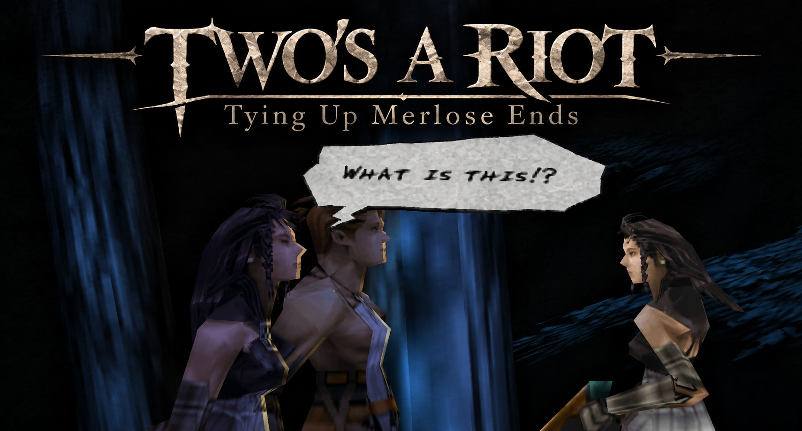

# Two's a Riot: Tying Up Merlose Ends

*A Vagrant Story mod: Merlose joins Ashley as a companion.*

Callo Merlose, the VKP inquisitor from the opening, follows Ashley through Leá Monde as a fully
AI-controlled party member. She fights, heals and casts spells on her own, while you choose her
equipment and which of Ashley's spells she may use.

## Oh, and by the way...

**Vagrant Story now has native Linux and Windows ports.**

*Maybe I should've led with that...*

The Windows port is based on **noprompt**'s **[rood-boi](https://github.com/noprompt/rood-boi)**,
which builds on the **[rood-reverse](https://github.com/ser-pounce/rood-reverse)** decompilation
by **[ser-pounce](https://github.com/ser-pounce)** and **[Lil' Sassy](https://github.com/lil-sassy)** and the work of its other contributors. Without them, none of this would have been
possible. The decompilation has opened up possibilities for Vagrant Story modding that were
previously far beyond reach, and noprompt's Linux port was the foundation for the Windows one.

I developed the Windows port, which is now merged into rood-boi, and Two's A Riot has been
rebuilt to run natively on both Windows and Linux.

Both are experimental, with bugs and rough edges still to iron out. But the game runs, and we
can start exploring what this makes possible for the future of Vagrant Story.

Please give the original projects and their contributors the credit they deserve:

- **[rood-reverse](https://github.com/ser-pounce/rood-reverse)**: the decompilation, by ser-pounce, Lil' Sassy and its
  other contributors
- **[rood-boi](https://github.com/noprompt/rood-boi)**: the native ports

## Features

- **She fights beside you.** Merlose appears next to Ashley in every room, attacks enemies, heals
  and casts spells. Enemies fight back against her. She can be defeated, and comes back in the
  next room.
- **She grows with Ashley.** She copies his base stats with STR and INT swapped, so a
  strength-built Ashley gets a caster Merlose, and the other way round.
- **MERLOSE equipment menu.** A new MERLOSE entry in the ITEMS menu, next to EQUIP, uses the
  normal equip screens with her stats and her model. Each item can only be worn by one of them,
  her gear grows like Ashley's, and it's all kept in your save. She starts with her own bow,
  *VKP Standard Issue*.
- **Choose her spells.** In the MAGIC menu, **Square** gives the highlighted spell to Merlose or
  takes it back (up to 8).
- **Friendly targeting.** Ashley's attacks and single-target attack spells can't hit her, but
  area spells can catch her; his healing, support spells and items work on her.
- **Quality of life.** Rooms clear without having to beat her, the STATUS screen shows her
  stats, small HP/MP/RISK bars for her sit under Ashley's, and she catches up if she's left
  behind.
- **Cutscenes.** She steps out for cutscenes and the prologue, and is back when they end.
- **Optional extras** (the patcher and builders ask whether you want them): permanent stat-up
  items always give their maximum (+4), and the bonus wheel after a boss is chosen instead of
  spun (**Down/Up** to pick, **Circle** to take it; with this, the wheel doesn't spin).

## Compatibility

- **Game:** Vagrant Story, USA (SLUS-01040). You need your own copy; nothing from the game is in
  this repository or any download.
- **Native PC (rood-boi):** Windows 10/11 and 64-bit Linux. The QoL mod's weapon slots are built
  into rood-boi (switch them on in its editor); Zenith, the Randomizer and the rest of the QoL mod
  are patches for the PlayStation version and don't apply there.
- **PlayStation version:** [Zenith](https://vszenith.wordpress.com/) (1.94), the
  **[QoL mod](https://github.com/eremtsov/rood-reverse/releases)** (eremtsov, v3.1) and the
  **Vagrant Story Randomizer** (ChaoticBrave, 0.9.2.0): all supported. Apply this mod last:
  your disc → Zenith → QoL or randomizer → this mod. With QoL's default (Cross confirms)
  version, the choosable bonus wheel is left out, since QoL changes that screen too.
- **Saves:** existing saves work; her settings live in save data the game doesn't use.
- **Hardware (PlayStation version):** runs on a standard 2 MB PlayStation; developed in
  DuckStation.

## Getting it

Nothing from the game is downloaded: everything is built or patched from your own disc image of
Vagrant Story (USA), as a `.bin` + `.cue`.

| Play it on | What you get | Download |
| --- | --- | --- |
| **Windows** | rood-boi, the native PC version, with Merlose | **[Windows builder](https://github.com/Daemeous/rood-boi/releases/latest)** (`rood-boi-native-builder-*.zip`, no WSL; or `rood-boi-builder-*.zip`, with WSL) |
| **Linux** | rood-boi, the native PC version, with Merlose | **[Linux builder](https://github.com/Daemeous/rood-boi/releases/latest)** (`rood-boi-linux-builder-*.tar.gz`) |
| **An emulator** (or a real PlayStation) | the PlayStation version, patched | **[Patcher](https://github.com/Daemeous/Twos-A-Riot-Tying-up-Merlose-Ends/releases/latest)** (`Twos-A-Riot-Merlose-*.zip`, Windows) |

### Native PC version (Windows or Linux)

The builder compiles rood-boi on your PC from the source code and your disc. Your disc image has
to be unmodified (no Zenith or other patches).

- **Windows:** extract the zip, put your `.bin` + `.cue` in the folder and double-click
  **Build rood-boi.bat**. Then play with **play-callo.bat** in the new `rood-boi` folder.
  There are two Windows builders:
  - `rood-boi-native-builder-*.zip` (new): needs no WSL, no admin rights and no restart. It
    downloads its own build tools (MSYS2, Python and Windows builds of the PlayStation
    compilers) into its folder. The first build takes 30-60 minutes.
  - `rood-boi-builder-*.zip`: builds in WSL (Windows' built-in Linux), which it installs the
    first time (that needs a restart).
- **Linux:** install Podman (or Docker), extract the archive, put your `.bin` + `.cue` in the
  folder and run `./build-rood-boi.sh`. Then play with `rood-boi/play-callo.sh`.

The builder starts by asking whether to include Merlose and her extras, and remembers your
answers for next time. Run the builder again to update. The README in each download has the
details.

### PlayStation version (emulators)

**[Download the patcher](https://github.com/Daemeous/Twos-A-Riot-Tying-up-Merlose-Ends/releases/latest)**
(Windows 10/11, nothing to install):

1. Extract the zip and copy your Vagrant Story (USA) `.bin` + `.cue` into the extracted folder.
2. Double-click **Patch Vagrant Story.bat** and answer the questions, starting with which extras
   you want. (If Windows says "Windows protected your PC", click **More info → Run anyway**.)
3. Open the new `... + Merlose.cue` in your emulator. Your original image isn't changed.

For Zenith, put its `.ppf` in the same folder and answer **Y** when asked. For the QoL mod,
patch your disc with QoL first (its own `.xdelta`, following its instructions), then run the
patcher on that disc. For the Randomizer, randomize first and patch the randomized disc. The
README in the zip covers `.chd` files and troubleshooting.

## How it's made

The mod is built on **[rood-reverse](https://github.com/ser-pounce/rood-reverse)** (by ser-pounce,
Lil' Sassy and its other contributors), the decompilation of Vagrant Story, which turns the game's code back into readable C. Two editions
come from the same source:

- **Patch edition** (the one to use): a few small patches to the original game files plus two
  new files on the disc, so it can go on top of Zenith or the randomizer.
- **Decomp edition** (experimental, in development): Merlose compiled straight into the rebuilt
  game code. This needs the in-progress decompilation from
  [rood-reverse PR #186](https://github.com/ser-pounce/rood-reverse/pull/186), and doesn't mix
  with mods that patch the original files.

The native PC version comes from the same mod source, compiled into
**[rood-boi](https://github.com/Daemeous/rood-boi/tree/callo)** (`callo` branch;
`pc/run-game.sh --vulkan --callo` builds and plays it by hand on Linux).

Developed with [Claude Code](https://claude.com/claude-code).

## Update (15 October)

- **The patcher and builders now ask which extras you want** when they start, instead of
  switching them on by default: with the choosable bonus wheel, the wheel after a boss doesn't
  spin (you pick the reward), which looked like a freeze to players who didn't know it was on.
  Your answers are remembered, and the next run asks whether to keep them.
- **A Windows builder without WSL** (`rood-boi-native-builder-*.zip`): no WSL, admin rights or
  restart needed.
- **rood-boi updated** to noprompt's latest (signs drawn from the font, warp fixes, faster
  launch, and more).

## Update (14 October)

Most of the known issues are fixed. Download the latest
[PlayStation patcher](https://github.com/Daemeous/Twos-A-Riot-Tying-up-Merlose-Ends/releases/latest)
and patch your original disc again, or run the
[Windows/Linux builder](https://github.com/Daemeous/rood-boi/releases/latest) again to update.

- **Stat-up items** no longer crash the game with Zenith. The stat-up extra is now a choice:
  always +4, Zenith's best roll, or the game's own roll.
- **Merlose appears where she was missing:** the Wine Cellar's first room, and on PC, rooms with
  no enemies (workshops, small rooms, the first room of Snowfly Forest).
- **Spells** can be changed again (unlearned default spells no longer fill her list).
- **Workshop repairs** fix her gear too.
- **Her weapon** is drawn when enemies are around and otherwise follows Ashley's, so it no longer
  drains PP out of combat.
- **Jumping** uses her own jump and landing poses.
- **Staves:** she can equip them now, for a caster Merlose with their big INT bonus.
- **PC (rood-boi) fixes**, also sent to rood-boi:
  - saves are kept on Windows (they were silently lost after the first save)
  - no more crash entering the Lamenting Mother's room
  - a crash guard for spell effects (seen with a Hellhound's Fire Breath)

## Known issues

- With a staff she uses her bare-hands animations, so the staff isn't shown while she attacks.

## Not yet playtested

- The later parts of the game. Some rooms there may still crash on entry or be missing
  Merlose, so please report any you find on the
  [Issues](https://github.com/Daemeous/Twos-A-Riot-Tying-up-Merlose-Ends/issues) page.

## Credits

- **[ser-pounce](https://github.com/ser-pounce)**, who started rood-reverse and has done the overwhelming majority of the work on it, and
  **[Lil' Sassy](https://github.com/lil-sassy)**, one of its most prolific contributors: the decompilation this is built on. Thanks also
  to every other rood-reverse contributor.
- **noprompt**, for rood-boi, the native PC port, and for PR #186.
- **Zenith**: lead author **the_E_y_Es_o_0**, with collaborators **Valendian** and **Rosto**.
- **ChaoticBrave**, for the Vagrant Story Randomizer.
- **eremtsov**, for the QoL mod.
- The patcher zip includes the official embeddable [Python](https://www.python.org) (Python Software
  Foundation, PSF licence).

- Vagrant Story © Square Enix. This is a fan project, not affiliated with or endorsed by Square
  Enix.

Code in this repository is released under [CC0](LICENSE), like rood-reverse.

☕ Support My Work

If you've enjoyed this mod and would like to support me or my other projects, you can buy me a coffee on Ko-fi!

Absolutely no obligation, though, everything I make is because I'm passionate about it, and your enjoyment is already a reward in itself. Please take care of you and yours first!

I want to be clear that I stood on the shoulders of giants to make this. [ser-pounce and Lil' Sassy's rood-reverse](https://github.com/ser-pounce/rood-reverse) and [noprompt's rood-boi](https://github.com/noprompt/rood-boi) are the real MVPs who made this possible. If you'd like to support the people whose work made this project possible, please consider supporting them, too!

[☕ Support me on Ko-fi](https://ko-fi.com/daemeous)
